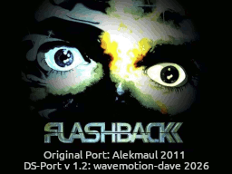

# Flashback DS

Flashback DS is based on REminiscence engine (http://cyxdown.free.fr/reminiscence/).
This game was made by Delphine Software and released in 1992. More information can be 
found online.

# Instructions

This will be the hardest game you've ever assembled to play on your DS :)

Create a directory on your SD card at the root called 'FLASHBACK'

Inside this directory, you will accumulate the data files needed to play.

At a minimum, you will need the original game datafiles of the PC (recommend CD) release. 
You can use English, French, German or Spanish version. On the PC (DOS) CD you will find a DATA directory with tons
of files in it. Copy all of those files to the /FLASHBACK directory you made on your SD card.

At this point, you should be able to play... but you'll want some extras:
	
To hear background music during polygonal cutscenes, you'll need to copy the .mod files of the Amiga version :

	mod.flashback-ascenseur
	mod.flashback-ceinturea
	mod.flashback-chute
	mod.flashback-desintegr
	mod.flashback-donneobjt
	mod.flashback-fin
	mod.flashback-fin2
	mod.flashback-game_over
	mod.flashback-holocube
	mod.flashback-introb
	mod.flashback-jungle
	mod.flashback-logo
	mod.flashback-memoire
	mod.flashback-missionca
	mod.flashback-options1
	mod.flashback-options2
	mod.flashback-reunion
	mod.flashback-taxi
	mod.flashback-teleport2
	mod.flashback-teleporta
	mod.flashback-voyage
    
If you search for "Flashback Amiga ExoticA" you will be on your way to finding these mod files.

Lastly, to hear voice during in-game dialogues, you'll need to copy the 'VOICE.VCE'
file from the SegaCD version to the /FLASHBACK directory.  Good luck finding that one :)

These files are copyrighted and will NOT be distributed with this release. Don't even ask.
	
To start the game, you must :
- create a directory at the root of your card named FLASHBACK
- put the original game's datafiles in the directory named FLASHBACK
- run Flashback-DS.nds

Controls :
 * Direction pad : the joystick ... 
 * A           : draw/holster gun
 * B           : talk / use / run / shoot
 * X           : use the current inventory object
 * Y           : Jump (shortcut for D-Pad Up)
 * R / START   : display the inventory / skip movies
 * L / SELECT  : display the options menu
 
# Credits

Thanks Wintermute for devkitpro and libnds (http://www.devkitpro.org).
  Benoist Aron, Thierry Levastre, Thierry Perreau, Delphine Software, obviously, 
    for making this great game.
  
  Gregory Montoir, cyx@users.sourceforge.net (original REminiscence for PC)
  
  Biggest thanks to Alekmaul for the original port to the DS.

--------------------------------------------------------------------------------

# History 

V1.2 : 25-Nov-2026 by wavemotion-dave
  * Improved video playback - DS-Lite now runs at proper rate.
  * Fix to allow direct run on DSi from TWL++ or Unlaunch
  * Fix memory leak (was leaking almost 50K per cut-scene).
  * Added 'GAME SAVED' indication when saving.
  * Load Game now restores the last saved game slot you used.
  * Improved mixing of sound to help avoid clipping and reduce 'static'.
  * Y button (Jump) overrides LEFT/RIGHT for smoother control.
  * Menus now show in zoomed 1:1 resolution for improved clarity (you can read the text easily).
  * Cutscenes now zoom so that none of the 128 vertical pixel lines are compressed and lost.

V1.1 : 09/10/2011
  * Fix save/load problem
  * Invert A & X buttons, R instead of Y for inventory, Y to jump
  * Add confirmation before switching back to menu
  * Some speed improvments
  * Fix brightness problem when an error occured
  * Remove zlib include, useless for this version
  * Remove assertion with flag NDEBUG

V1.0 : 24/07/2011
  * Initial release based on REminiscence engine
  
